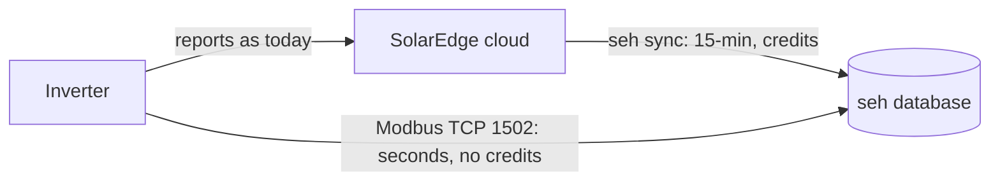
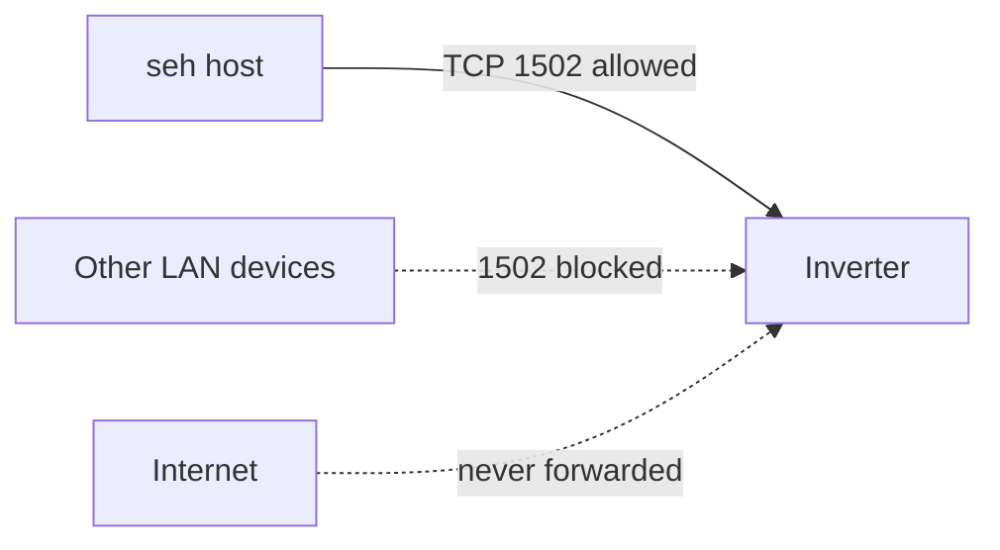
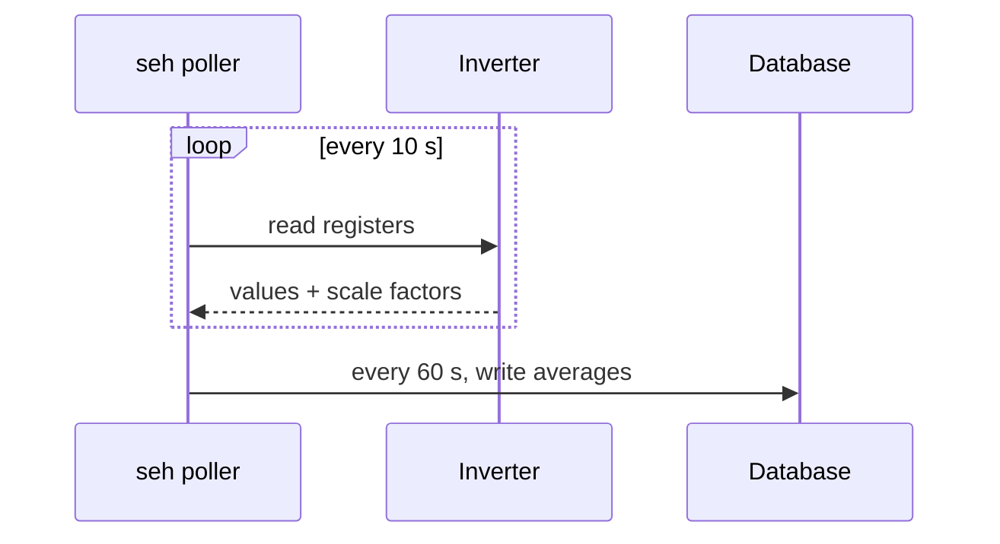
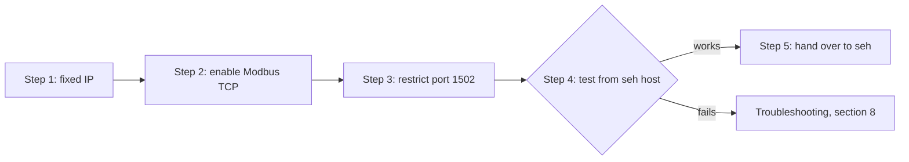
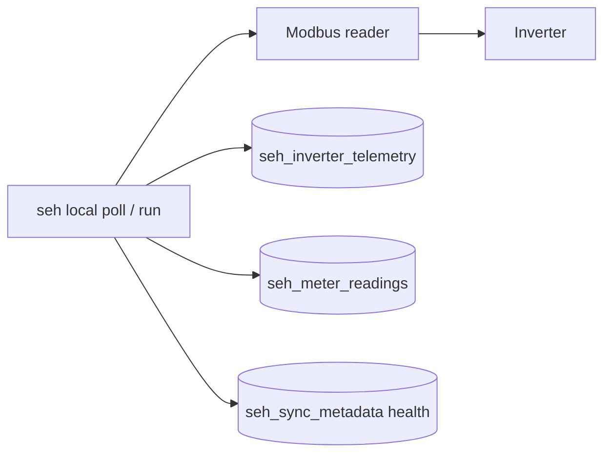

# Reading Data Directly from the Inverter (Local Modbus TCP)

> **Status: proposal, not implemented.** seh 0.3.0 collects data only from the SolarEdge cloud
> (Monitoring API V2). This document explains how seh could also read live data straight from a
> SolarEdge inverter on the local network, what that would take, and the work involved. Nothing
> described under "seh changes" exists yet.

---

## Contents

1. [Introduction](#1-introduction)
2. [What data you get](#2-what-data-you-get)
3. [Pros and cons](#3-pros-and-cons)
4. [Considerations](#4-considerations)
5. [Instructions](#5-instructions)
6. [Proposed seh changes](#6-proposed-seh-changes)
7. [Follow-up and ongoing work](#7-follow-up-and-ongoing-work)
8. [Troubleshooting](#8-troubleshooting)
9. [Sources](#9-sources)

---

## 1. Introduction

### Why this exists

When seh moved from the SolarEdge Monitoring API V1 to V2 (seh 0.3.0), most data kept its
resolution. Production, consumption, grid import/export and daily energy are still 15-minute or
daily values, and they matched V1 exactly. One series got coarser, and some fields disappeared:

| Data | API V1 | API V2 |
|---|---|---|
| Inverter AC power, voltage, current, frequency | about every 5 minutes | 15-minute averages |
| Inverter temperature, operating mode, DC voltage, power limit, reactive power | available | **not available** |
| Anything finer than 15 minutes | no | no (V2 lists a `RAW` resolution but rejects it) |

The cloud API cannot provide more detail. The inverter itself can.

### How it works

SolarEdge inverters can publish their live readings on the local network using **Modbus TCP**.
Modbus is a long-established industrial protocol for reading values from equipment, and
SolarEdge follows the **SunSpec** standard for how solar equipment lays those values out. The
feature is **off by default**. Once switched on, any program on the network can ask the inverter
for its current values, as often as it likes. Nothing goes through SolarEdge's servers.



### Who this applies to

- SolarEdge **residential inverters with firmware 4.x**, connected to the home network,
  **preferably by Ethernet**.
- seh's reference installation is a single-phase SolarEdge Home Wave / HD-Wave inverter
  (USE11400H series) on Ethernet with firmware 4.24.16, next to a Linux server running seh on
  the same network. Other SolarEdge models expose the same SunSpec data but may differ in menus
  and in how many phases they report.

---

## 2. What data you get

| Data | Cloud API V2 (seh today) | Local Modbus TCP |
|---|---|---|
| Inverter AC power, voltage, current, frequency | 15-minute averages | **Live values, as often as you poll** (every 10 s is typical) |
| Inverter heat-sink temperature | No | **Yes** (unavailable at night when the inverter sleeps) |
| Inverter status / operating mode | No | **Yes** |
| DC (panel-side) voltage, current, power | No | **Yes** |
| Inverter lifetime energy counter | No | **Yes** |
| Apparent / reactive power, power factor | No | **Yes** |
| Meter: grid import/export power and energy, per phase | 15-minute averages | **Live values** (up to three meters) |
| Battery: state of energy, power, temperature, health | 15-minute telemetry (unverified) | **Yes** (up to three batteries) |
| Per-panel (optimizer) data | No | **No.** Not available locally either. |
| Site details, inventory, alerts, environmental benefits | Yes | No (stay on the cloud API) |

Local data **adds to** the cloud data rather than replacing it. Site details, inventory, daily
energy history, and the 15-minute series that downstream reports rely on remain on the cloud
sync.

---

## 3. Pros and cons

### Pros

- **Much finer resolution.** Seconds instead of 15-minute averages, so you see short events:
  cloud shadows, load spikes, clipping at the inverter's limit, export dips.
- **Data V2 dropped.** Temperature, operating status and mode, DC voltage, current and power,
  power factor.
- **No API credits.** Reads are local and unmetered. This also reduces dependence on SolarEdge's
  cloud plan and policy changes.
- **Works during internet outages.** Local readings continue while the cloud is unreachable.
- **Fits the existing database.** `seh_inverter_telemetry` and `seh_meter_readings` already have
  columns for temperature, mode, DC voltage, per-phase values and power factor, so no schema
  change is needed for the basic version.

### Cons

- **One reader only.** SolarEdge supports a single Modbus "leader" per site. If another system
  (Home Assistant, a battery controller, an energy manager) already reads the inverter over
  Modbus, the two will conflict.
- **No security in the protocol.** Modbus TCP has no password or encryption. Anything that can
  reach port 1502 can read the data **and change settings** such as export limits and power
  controls.
- **Can be switched off without warning.** Users report that inverter firmware updates or
  installer visits have turned Modbus TCP off again.
- **More data to store.** One reading per minute is about 525,000 rows a year per table; every
  10 seconds is about 3.2 million.
- **Another moving part.** A service or frequent cron job to keep running and monitor, plus a
  new Python dependency (`pymodbus`).
- **Snapshots, not averages.** Modbus gives the value at the moment of the read. Unless seh
  averages several reads, a 1-minute series is a set of instantaneous samples, which differs
  slightly from the cloud's 15-minute averages.
- **No per-panel data.** Optimizer-level data is not exposed over Modbus.
- **Undocumented control behaviour.** The writable control registers are not fully documented
  and vary by firmware; seh would never write, but other tools might.

---

## 4. Considerations

### Network

- The inverter should have a **fixed IP address**: a DHCP reservation in the router, or a
  static IP set in the inverter's communication settings.
- **Ethernet is strongly preferred.** SolarEdge has changed Modbus-over-Wi-Fi support in past
  firmware. Release notes quoted by users describe Wi-Fi Modbus as supported only on secured
  Wi-Fi for residential inverters, and Home Assistant's documentation calls Ethernet "the more
  reliable choice".
- The seh host must reach the inverter on **TCP port 1502** (SolarEdge's default; generic Modbus
  devices often use 502).
- The inverter closes idle Modbus connections after about **2 minutes**. A long-running poller
  must reconnect cleanly.

### Security

Treat the inverter's Modbus port like an unauthenticated admin interface:



1. **Only the seh host should be able to reach port 1502.** Either:
   - add a router or firewall rule that blocks TCP 1502 to the inverter from every address
     except the seh host; or
   - put the inverter on its own network segment (VLAN) that only the seh host can reach.
2. **seh would only ever read.** It would use read-only Modbus calls and never write registers.
3. **Do not expose port 1502 to the internet** (no port forwarding, no UPnP).
4. Some users block the inverter's outbound internet access to stop automatic firmware updates
   from disabling Modbus. That also stops cloud monitoring, which seh needs, so it is **not
   recommended** here.

### Coexistence

- Only one Modbus reader at a time. Decide whether seh or another system (for example Home
  Assistant) owns the inverter's Modbus port.
- The cloud sync is unaffected: the inverter keeps reporting to SolarEdge as before.
- To avoid mixing resolutions, once local polling works, seh's cloud `inverter_telemetry` sync
  should be turned off (`SEH_SKIP_DATA_TYPES=...,inverter_telemetry`).

### Data volume and retention

| Poll interval | Rows per table per year | Rough size per table per year (MariaDB) |
|---|---|---|
| 60 s | about 525,000 | tens of MB |
| 10 s | about 3.2 million | a few hundred MB |

Consider polling every 10 s but **storing one-minute averages** (with min/max where useful),
which keeps detail while bounding storage:



Also decide on retention, for example keeping raw
1-minute data for a year and rolling it up after that.

### Data meaning

- The inverter heat-sink temperature and some DC values read as unavailable or zero at night,
  when the inverter sleeps.
- SunSpec values come as a raw number plus a **scale factor** (value x 10^SF). Both must be read
  in the same request, or a value can be paired with the wrong scale.
- The lifetime energy counter is a 32-bit accumulator spread over two registers and must be
  read as a pair.
- Timestamps would be taken on the seh host. seh stores naive site-local time; the host's clock
  should be synced with NTP.

---

## 5. Instructions



### Step 1: Give the inverter a fixed IP address

1. Find the inverter's current IP address in your router's list of connected devices. It is
   usually named after SolarEdge or the inverter serial number.
2. In the router, create a **DHCP reservation** that ties that IP address to the inverter's MAC
   address.
3. Note the IP address for the next steps.

### Step 2: Enable Modbus TCP on the inverter

No installer account is needed for this method.

**Inverters without a display (SetApp models, including Home Wave / HD-Wave US):**

1. Move the inverter's red **ON/OFF/P** switch to **P** and release it **within 5 seconds**.
   Holding it longer starts other functions (such as pairing), so keep it brief.
2. The inverter opens its own Wi-Fi access point. The network name and password are printed on
   the label on the inverter.
3. Connect a phone or laptop to that Wi-Fi network.
4. Open `http://172.16.0.1` in a browser. Alternatively, use SolarEdge's **SetApp** mobile app.
   Some SetApp logins need installer-granted access; the browser page does not.
5. Go to **Commissioning > Site Communication > Modbus TCP** and set it to **Enable**.
6. Leave the **port at 1502** and the **device ID at 1**.
7. Exit, disconnect from the inverter's Wi-Fi, and reconnect your device to your normal network.

**Inverters with a display (older models):**

1. Hold the **OK** button to enter the menu, enter the menu password `12312312` using the
   buttons, then go to **Communication > LAN** and enable **Modbus TCP**.

### Step 3: Restrict access to the Modbus port

1. In the router or firewall, allow TCP port 1502 to the inverter's IP address **only from the
   seh host**, and block it from all other devices. The exact steps depend on the router.
2. Alternatively, move the inverter onto a separate VLAN reachable only from the seh host.

### Step 4: Check that the seh host can reach the inverter

On the seh host, replacing `INVERTER_IP` with the address from Step 1:

```bash
# Is the port open? Expect "succeeded" or "open".
nc -vz INVERTER_IP 1502
```

Then read a few values with a short test script. This needs `pymodbus` (for example
`uv run --with pymodbus python check_modbus.py INVERTER_IP`):

```python
"""Read the SunSpec ID and AC power from a SolarEdge inverter (read-only)."""
import sys

from pymodbus.client import ModbusTcpClient

host = sys.argv[1]
client = ModbusTcpClient(host, port=1502, timeout=5)
client.connect()
try:
    # SunSpec ID "SunS" lives at protocol address 40000 (SolarEdge's technical note numbers
    # registers from 1, so it appears there as 40001).
    ident = client.read_holding_registers(40000, count=2, slave=1)
    raw = b"".join(r.to_bytes(2, "big") for r in ident.registers)
    print("SunSpec ID:", raw)  # expect b'SunS'

    # Inverter AC power and its scale factor: protocol addresses 40083-40084 (see section 5.1).
    power = client.read_holding_registers(40083, count=2, slave=1)
    value, sf = (r - 0x10000 if r & 0x8000 else r for r in power.registers)  # both signed int16
    print("AC power (W):", value * 10**sf)
finally:
    client.close()
```

Newer `pymodbus` releases rename the `slave=` argument to `device_id=`; adjust if you get a
keyword error. If the ID prints `b'SunS'` and the power matches the inverter's display or the
SolarEdge app, the connection works.

### 5.1 Register reference (verify before relying on it)

The table below lists commonly used registers for single-phase inverters as published by a
third party (ModbusCloud), in **0-based protocol addresses**. SolarEdge's own SunSpec technical
note numbers registers from 1, so its numbers are **one higher**. Confirm against the official
technical note, or with SunSpec auto-discovery, before building on them.

| Protocol address | Name | Type | Unit | Scale factor at |
|---|---|---|---|---|
| 40000 | SunSpec ID ("SunS") | 2 x uint16 | - | - |
| 40069 | Inverter model (101 single, 102 split, 103 three phase) | uint16 | - | - |
| 40083 | AC power | int16 | W | 40084 |
| 40093 | AC lifetime energy | acc32 (40093-40094) | Wh | 40095 |
| 40100 | DC power | int16 | W | 40101 |
| 40103 | Heat-sink temperature | int16 | deg C | 40106 |
| 40107 | Operating status | enum16 | - | - |

AC current, AC voltage, frequency, DC voltage and DC current sit in the same inverter block
between these addresses, and the meter blocks follow the inverter block. Their exact addresses
are in SolarEdge's SunSpec technical note.

### Step 5: Hand over to seh

Once Step 4 succeeds, the seh-side work in section 6 can be built and tested against the real
inverter. For the reference installation: share the inverter's IP address and the preferred
poll interval (section 4, "Data volume").

### Turning it off again

To stop local reading at any time, repeat Step 2 and set Modbus TCP to **Disable**, or stop the
seh poller. The cloud sync is unaffected either way.

---

## 6. Proposed seh changes

Not implemented. A sketch for review:



| Piece | Description |
|---|---|
| Settings | `SEH_MODBUS_ENABLED`, `SEH_MODBUS_HOST`, `SEH_MODBUS_PORT` (default 1502), `SEH_MODBUS_UNIT_ID` (default 1), `SEH_MODBUS_POLL_SECONDS`, `SEH_MODBUS_STORE_SECONDS` (averaging window) |
| Reader | `src/seh/local/modbus.py` using `pymodbus` (new optional extra, `uv sync --extra modbus`): SunSpec discovery of the inverter and meter blocks, scale factors read together with values, read-only calls, reconnect after the 2-minute idle close |
| Command | `seh local poll` (one read, for cron every minute) and `seh local run` (long-running loop, for a systemd service polling every 10 s and storing 1-minute averages) |
| Storage | Inverter values into `seh_inverter_telemetry` (temperature, status/mode, DC voltage, AC values, lifetime energy) and meter values into `seh_meter_readings` (power, per-phase voltage and current, power factor, lifetime energy). No schema change for the basic version. |
| Cloud overlap | Document adding `inverter_telemetry` to `SEH_SKIP_DATA_TYPES` once local polling runs |
| Health | Log and record in `seh_sync_metadata` (data type `local_modbus`) when the inverter stops answering, so the existing email notification can report it (for example after a firmware update disables Modbus) |
| Tests | Fake Modbus server or mocked client for register decoding, scale factors, the 32-bit accumulator, night-time unavailable values, reconnects, and averaging |
| Docs | User guide section, settings reference, security notes |

Estimated effort: similar to the API V2 client work, including tests. It should be built and
verified against a real inverter with Modbus TCP enabled.

---

## 7. Follow-up and ongoing work

### Before building

- [ ] Enable Modbus TCP on the reference inverter and confirm Step 4 from the seh host.
- [ ] Restrict port 1502 to the seh host (Step 3).
- [ ] Choose the poll interval and storage granularity (raw 1-minute vs. 10-second polling with
      1-minute averages).
- [ ] Confirm the register addresses against SolarEdge's SunSpec technical note or by SunSpec
      discovery.
- [ ] Confirm no other system needs the inverter's single Modbus connection.

### Building

- [ ] Implement the reader, commands, settings and tests (section 6).
- [ ] Decide whether local inverter rows replace the cloud `inverter_telemetry` sync (recommended)
      and update `SEH_SKIP_DATA_TYPES`.
- [ ] Add a systemd unit or cron entry on the seh host, and log rotation.
- [ ] Document it in the README and DATA_SCHEMA.md (new data source per column).

### Ongoing

- **After every inverter firmware update or installer visit**, check that Modbus TCP is still
  enabled (seh's health record and notification should flag it).
- **Watch storage growth** and apply the retention or roll-up plan.
- **Keep the firewall rule** in place when changing routers or network layout.
- **Possible extensions:** per-phase meter analysis, inverter temperature vs. output (thermal
  derating), clipping detection, short-interval self-consumption, and battery state if a
  battery is added.

---

## 8. Troubleshooting

| Symptom | Likely cause and fix |
|---|---|
| `nc` reports the connection refused or timed out | Modbus TCP not enabled, wrong IP, or a firewall in between. Re-check Step 2 and the router rule. |
| Worked before, now refused | A firmware update or installer visit may have disabled Modbus TCP. Repeat Step 2. |
| Connects, then drops after a while | The inverter closes idle connections after about 2 minutes, or another Modbus reader took the single connection. |
| SunSpec ID is not `SunS` | Wrong device ID (try 1), wrong address convention (try 40001), or not a SolarEdge/SunSpec device. |
| Temperature or DC values are 0 or unavailable | Normal at night while the inverter sleeps. |
| Values look 10x or 100x off | Scale factor not applied, or read in a separate request from its value. |
| The inverter's Wi-Fi access point does not appear | The P switch was held too long or too briefly. Move it to P and release within 5 seconds. |

---

## 9. Sources

- [SolarEdge - SunSpec Implementation Technical Note (PDF)](https://knowledge-center.solaredge.com/sites/kc/files/sunspec-implementation-technical-note.pdf):
  the official reference for Modbus TCP and SunSpec registers. Modbus TCP is disabled by
  default, uses port 1502, and supports a single Modbus leader. The download may require a
  browser; it was not machine-readable when this document was written.
- [Home Assistant - SolarEdge Modbus integration](https://www.home-assistant.io/integrations/solaredge_modbus/):
  enabling without an installer (P switch and `http://172.16.0.1`, or the display menu), port
  1502 and device ID 1, available inverter, meter and battery data, connection limits, firmware
  caveats, the Ethernet recommendation, and 10-second polling.
- [ModbusCloud - SolarEdge Modbus TCP: port 1502 and the SunSpec registers](https://www.modbuscloud.com/knowledge-base/solaredge-modbus-tcp):
  register addresses for AC power, lifetime energy, DC power, heat-sink temperature and status;
  the single leader and the 2-minute idle disconnect. Vendor page; verify addresses.
- [Reduxi - Configuring SolarEdge inverters with SetApp for Modbus TCP](https://support.reduxi.eu/hc/en-us/articles/13723746308369-How-to-add-SolarEdge-Solar-Power-Plant-Inverter-with-SolarEdge-SetApp-application-to-Reduxi-Controller):
  static IP and port setup; residential firmware 4.x requirement for Wi-Fi Modbus.
- [home-assistant.io issue #23803 - firmware update disabled and later restored Modbus](https://github.com/home-assistant/home-assistant.io/issues/23803):
  user reports on firmware changes to Modbus over Wi-Fi.
- [Geeker's Digest - How to restart RS485 / Modbus TCP on a SolarEdge inverter](https://www.geekersdigest.com/how-to-restart-rs485-modbus-tcp-on-solaredge-inverter/):
  SetApp access requires a SolarEdge login.
- [Home Assistant Community - SolarEdge Modbus TCP custom component](https://community.home-assistant.io/t/custom-component-solaredge-modbus-tcp/165625):
  long-running community thread on local SolarEdge Modbus use.
- [openHAB Community - Reading data from SolarEdge inverters via Modbus TCP](https://community.openhab.org/t/reading-data-from-solaredge-inverters-via-modbus-tcp/26290?page=7):
  user experience with addresses, ports and SunSpec discovery.

Related seh documents: [MIGRATING_TO_API_V2.md](MIGRATING_TO_API_V2.md) (what changed in the
cloud data) and [DATA_SCHEMA.md](DATA_SCHEMA.md) (table columns).
